# BI10 Round 2 — Customer Financial Health and Engagement

**Who is in the data.** 1,000,528 customers, every one of whom applied for credit in Dec-2024/Jan-2025:
the Tet-2025 applicant cohort (12x normal monthly volume, 32% first-time applicants).
Scores are taken at **T = 2025-06-05**, the day after the last contract record; calls continue to Aug-2026 and
are kept as an untouched future window for validation.

**Financial Health Score (FHS, 0-100).** Points scorecard on 7 credit-history factors plus a live-status layer.
* Out of time (2024 data, never used for fitting): band E is 10x as stressed as band A
  (16.0% vs 1.6%); AUC 0.629.
  Gradient boosting on the same inputs: 0.613 vs scorecard 0.611 - no gain from complexity.
* A year later (Jan-Aug 2026, untouched): 40% of band E and
  14% of band D are in collection, vs at most
  3.5% in A-C.
* 11,751 customers are in **live arrears** today; 63% of them are in collection within 15 months.

**Customer Engagement Score (CES, 0-100).** Customer-initiated activity only (97% of calls and 97% of leads are company-pushed).
* On calls after T the top CES decile converts 15x the bottom decile
  (AUC 0.76 for a sale, 0.68 for interest).

**What the business should change now**
1. **Re-target telesales by CES.** Passive customers absorb 32% of delivered offers and bring
   9% of sales; highly engaged customers bring 60%
   (71 vs 7 sales per 1,000 offers).
2. **Cap dialling.** 21% of dials go to people who ignored 10+ calls (1.4% answer).
   A 10-attempt cap saves 802k dials and loses 4.4% of contacts.
   Call 7-10am and 5pm.
3. **Responsible-lending guardrail.** Over-extended customers are the most-offered segment (17.2% offered);
   customers already in collection are offered credit as often as healthy ones (10.7% vs
   12.1%) and signed 69 new loans. Block offers on live arrears; require an
   affordability check for over-extended customers.
4. **Tet underwriting.** First loans in the Tet wave were 2.1x as risky as repeat loans;
   78% of first-time borrowers had no prior footprint. Down payment is the strongest affordability signal in the score.
5. **Lead sourcing.** RA leads are 53% of all leads and convert 0.2%;
   SOB and landing-page leads convert 40% and 38%.

---

## 1. Business understanding and data

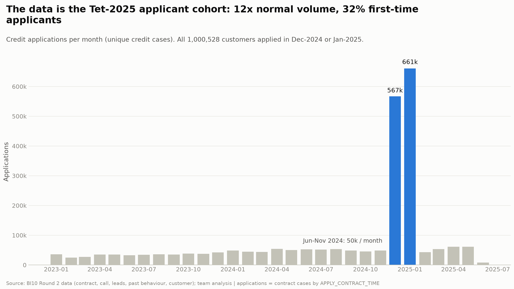
*Figure: Monthly credit applications; the Tet-2025 wave defines the file. Source: BI10 Round 2 data, team analysis.*

* The file is an **applicant cohort**: all 1,000,528 customers applied in Dec-2024/Jan-2025; 32% applied for the
  first time. Consequence: an outcome like "applies after Dec-2024" is true by construction, so it is never used for validation.
* Contracts, leads and behaviour end on 2025-06-04 (scoring date T = 2025-06-05). Calls run Jan-2025 to Aug-2026: the
  15 months after T are the independent future window.

### Data traps fixed in Phase 1

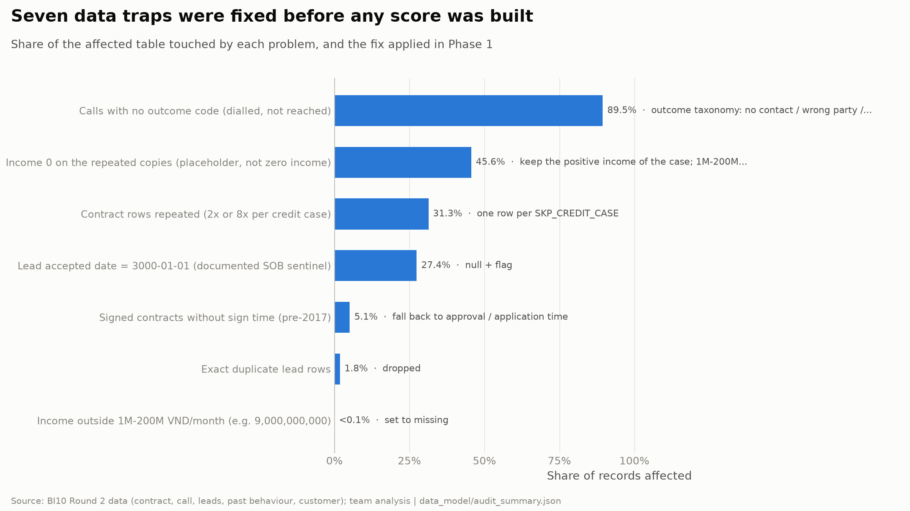
*Figure: Data problems, their size and the fix. Source: BI10 Round 2 data, team analysis.*

| trap | affected | share | fix | impact_if_ignored |
|---|---|---|---|---|
| Contract rows repeated (2x or 8x per credit case) | 1,953,716 | 31.3% | one row per SKP_CREDIT_CASE | every count and amount inflated x1.456 |
| Income 0 on the repeated copies (placeholder, not zero income) | 1,953,406 | 45.6% | keep the positive income of the case; 1M-200M VND/month valid | 306k customers wrongly treated as "income unknown" |
| Calls with no outcome code (dialled, not reached) | 3,578,524 | 89.5% | outcome taxonomy: no contact / wrong party / sales / collection / service | dialling counted as customer engagement |
| Lead accepted date = 3000-01-01 (documented SOB sentinel) | 587,914 | 27.4% | null + flag | acceptance delays of ~975 years |
| Signed contracts without sign time (pre-2017) | 218,712 | 5.1% | fall back to approval / application time | old history dropped from tenure and repayment |
| Exact duplicate lead rows | 39,249 | 1.8% | dropped | lead activity overstated |
| Income outside 1M-200M VND/month (e.g. 9,000,000,000) | 377 | 0.0% | set to missing | instalment-to-income near 0 |

The previous version of this pipeline treated the income placeholder as a genuine conflict and lost the income of 306k customers;
it is fixed. Every source file is checked against the SHA-256 of the distributed file before it is read.

### Right-censoring and the Tet risk

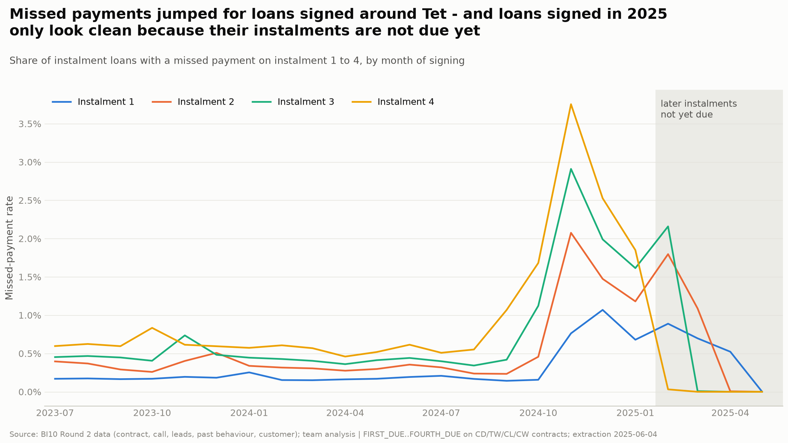
*Figure: Missed-payment flags by month of signing. Source: BI10 Round 2 data, team analysis.*

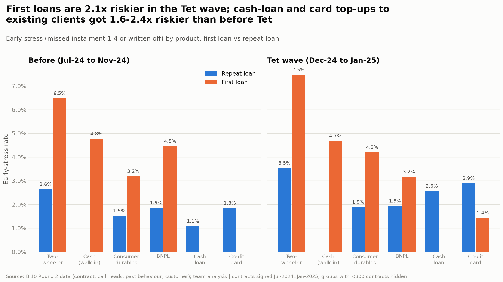
*Figure: Early stress by product, first vs repeat loan. Source: BI10 Round 2 data, team analysis.*

* Missed-payment flags exist only for instalments 1-4, and only once each instalment has fallen due. Every feature is therefore
  computed *as of* a date with a seasoning rule (instalment k counts only if the loan was signed k+1 months earlier).
* Loans signed Oct-2024 to Jan-2025 show 3-6x the usual missed-payment rate. First loans in the wave: 4.4% early stress vs
  2.1% for repeat loans; first-time two-wheeler loans 7.5%.

---

## 2. Task 1 — Financial Health Score

### Method

| Step | Choice | Why |
|---|---|---|
| Target | Stress after a date: a new loan misses instalment 1-4 or is written off; an existing loan misses an instalment falling due after the date; a young loan is written off | The only repayment outcome in the data; covers new and existing exposure |
| Time design | Train on snapshots 2023-07-01 and 2024-01-01 (6-month windows); test out of time on 2024-07-01 (to Jan-2025) | No future information; the test includes the Tet wave |
| Model | Weight-of-evidence bins + logistic regression, points-to-double-odds scale (2% stress = 60 pts, odds x2 = +10) | Every point is readable; ML is not required by the brief |
| Thin file | Separate scorecard for the 182,114 customers with no signed contract; flagged *provisional* | 78% of first-time borrowers have no prior footprint at all |
| Live status | Points for collection contact Jan-Jun 2025 and an affordability flag, fitted on calls Jun-Dec 2025 and validated on calls Jan-Aug 2026 | The contract table cannot see arrears after instalment 4 |
| Demographics | Not inputs; used only in a fairness check | Brief: no demographic risk factors without justification |

### Drivers (what raises and lowers financial health)

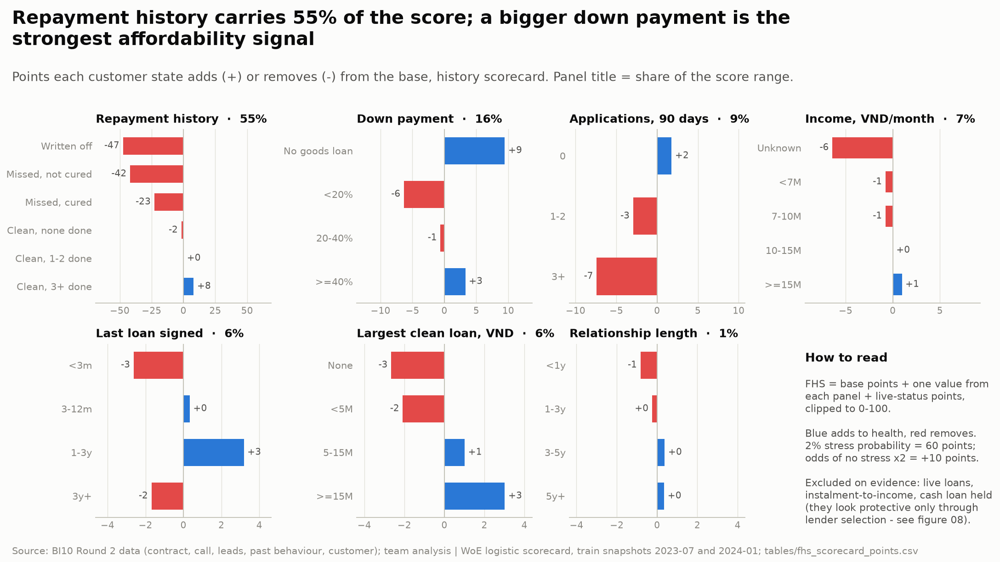
*Figure: Points per factor state, history scorecard. Source: BI10 Round 2 data, team analysis.*

| feature | pillar | share of score range % |
|---|---|---|
| repay_state | Repayment | 55.2 |
| down_payment | Affordability | 15.7 |
| apps_90d | Credit seeking | 9.1 |
| income | Affordability | 7.3 |
| recency | Stability | 5.8 |
| max_clean_credit | Proven capacity | 5.6 |
| tenure | Stability | 1.2 |

Information Value per candidate (train vs out of time). Features whose signal flips over time or only reflects the lender's own
selection were excluded and stay listed with the reason:

| feature | pillar | train | oot | status |
|---|---|---|---|---|
| repay_state | Repayment | 0.494 | 0.215 | candidate |
| due_recency | Repayment | 0.442 | 0.180 | excluded - duplicates repay_state (cured vs not cured) with a weaker, less stable signal |
| max_clean_credit | Proven capacity | 0.118 | 0.056 | candidate |
| recency | Stability | 0.066 | 0.015 | candidate |
| active_cash | Affordability | 0.065 | 0.003 | excluded - cash-loan holders passed stricter underwriting; IV unstable over time |
| apps_90d | Credit seeking | 0.050 | 0.021 | candidate |
| tenure | Stability | 0.047 | 0.046 | candidate |
| n_active | Affordability | 0.019 | 0.001 | excluded - looks protective only because the label sees instalments 1-4 and the lender tops up trusted clients; collection calls after T rise with the number of live loans (selection effect) |
| down_payment | Affordability | 0.017 | 0.032 | candidate |
| income | Affordability | 0.015 | 0.002 | candidate |
| pti | Affordability | 0.010 | 0.007 | candidate |
| rejected_12m | Credit seeking | 0.010 | 0.022 | excluded - the lender's own past decision (circular); weak and unstable |
| scoring_90d | Credit seeking | 0.002 | 0.015 | excluded - direction flips between train (protective) and out-of-time (risky) |

### Validation

| check | n | event_rate | auc | gini | ks |
|---|---|---|---|---|---|
| Train, in time | 557,190 | 0.013 | 0.6788 | 0.3577 | 0.2551 |
| Out of time, all | 727,865 | 0.0316 | 0.6288 | 0.2576 | 0.223 |
| Out of time, credit history | 490,105 | 0.0237 | 0.6114 | 0.2229 | 0.1573 |
| Out of time, thin file | 237,760 | 0.0478 | 0.526 | 0.052 | 0.0516 |
| Benchmark: repayment history only | 490,105 | 0.0237 | 0.5997 | 0.1993 | 0.1309 |
| Benchmark: gradient boosting, same inputs | 490,105 | 0.0237 | 0.6125 | 0.2249 | 0.1646 |

* Weight perturbation (every factor x0.75-1.25, 200 draws): rank correlation >= 0.9851; AUC 0.6082-0.6128.
* PSI train vs out of time 0.0744; train vs production (customers with a live loan) 0.0388 (stable < 0.1).

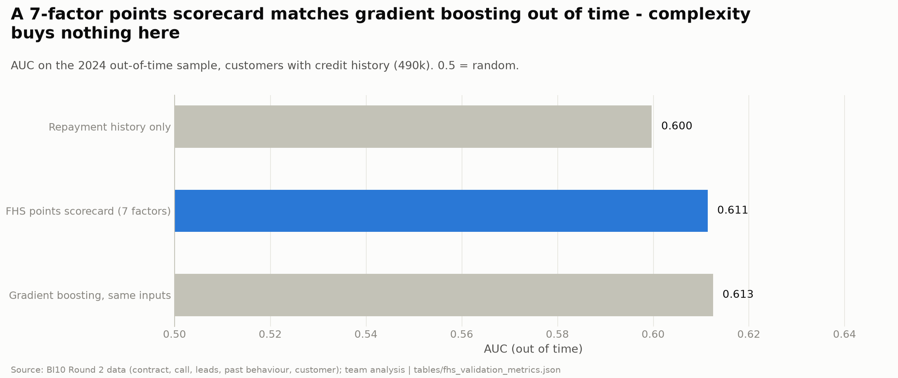
*Figure: Scorecard vs benchmarks out of time. Source: BI10 Round 2 data, team analysis.*

### The lender-selection paradox and the live-status layer

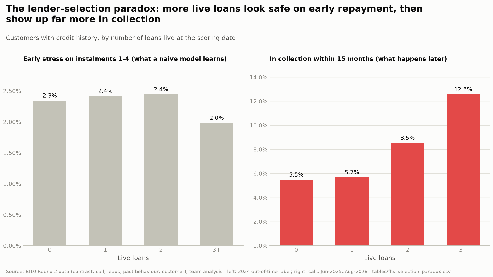
*Figure: Early stress vs later collection by number of live loans. Source: BI10 Round 2 data, team analysis.*

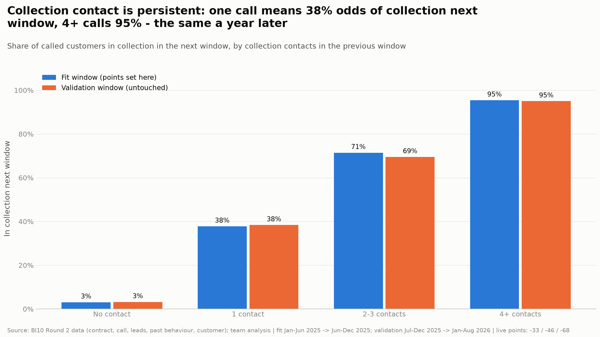
*Figure: Collection persistence, fit vs validation window. Source: BI10 Round 2 data, team analysis.*

* On the early-delinquency label, customers with 3+ live loans look *safer* (2.0%),
  because the lender only tops up clients it trusts. After T they are in collection 12.6% of the time vs
  5.7% with one loan. Live loans and instalment-to-income are therefore not rewarded by the score.
* Live points (fit window): 1 collection contact -32.6, 2-3 contacts -46.4, 4+ contacts -67.5,
  affordability flag -4.4. On the untouched window the final FHS reaches AUC 0.6698 for later collection
  (structural part alone 0.4741). The affordability points cost almost nothing on the 2024 label
  (AUC 0.6288 -> 0.6277).

### Bands and segments

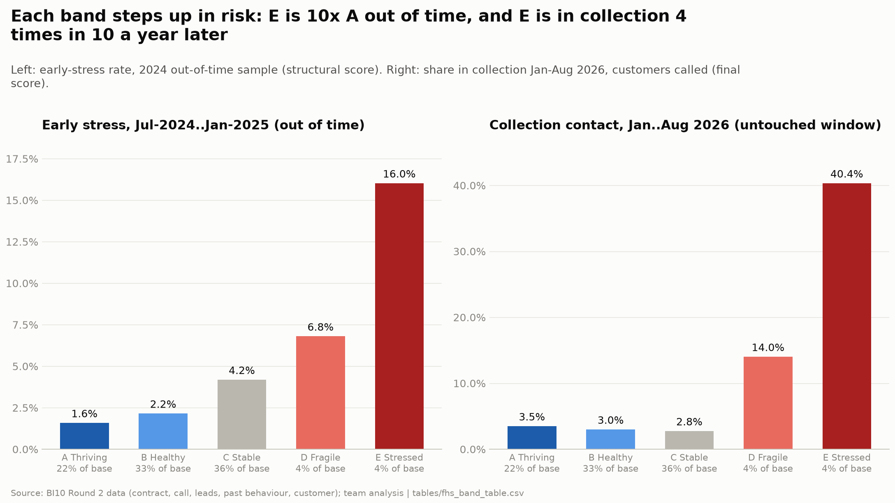
*Figure: Stress by band, out of time and one year later. Source: BI10 Round 2 data, team analysis.*

| band | score_min | score_max | stress_rate_oot | stress_lift_vs_A | future_collection_rate_validation_window | share_production |
|---|---|---|---|---|---|---|
| A Thriving | 75 | 94 | 1.6% | 1.0x | 3.5% | 22.4% |
| B Healthy | 65 | 75 | 2.2% | 1.4x | 3.0% | 33.1% |
| C Stable | 55 | 65 | 4.2% | 2.6x | 2.8% | 36.5% |
| D Fragile | 40 | 55 | 6.8% | 4.3x | 14.0% | 4.3% |
| E Stressed | 8 | 40 | 16.0% | 10.1x | 40.4% | 3.7% |

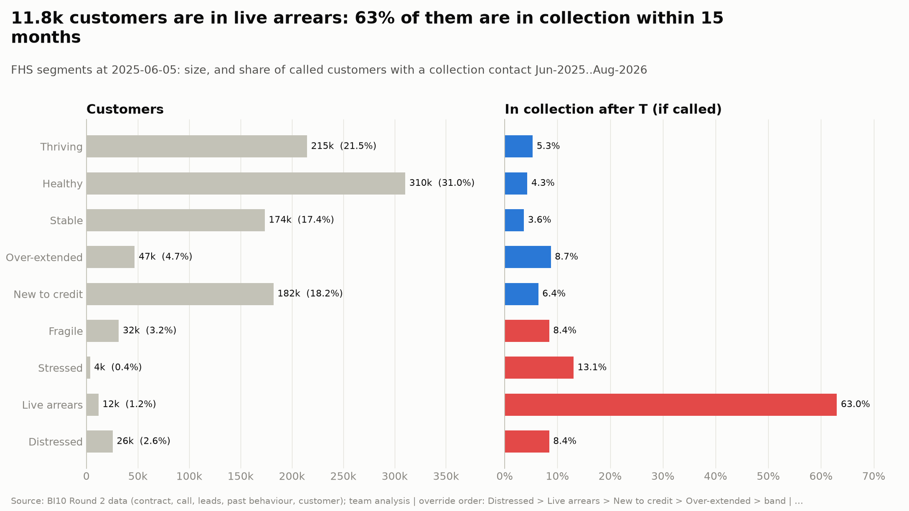
*Figure: FHS segments. Source: BI10 Round 2 data, team analysis.*

| fhs_segment | customers | share | avg_score | expected_stress | collection_rate_after_T |
|---|---|---|---|---|---|
| Thriving | 214,812 | 21.5% | 79.3 | 1.6% | 5.3% |
| Healthy | 310,439 | 31.0% | 70.0 | 2.2% | 4.3% |
| Over-extended | 47,030 | 4.7% | 66.2 | 3.3% | 8.7% |
| Stable | 173,619 | 17.4% | 62.0 | 4.2% | 3.6% |
| New to credit | 182,114 | 18.2% | 58.9 | 4.2% | 6.4% |
| Fragile | 31,558 | 3.2% | 47.2 | 6.8% | 8.4% |
| Stressed | 3,568 | 0.4% | 36.8 | 16.0% | 13.1% |
| Live arrears | 11,751 | 1.2% | 33.3 | 12.9% | 63.0% |
| Distressed | 25,637 | 2.6% | 22.0 | 16.0% | 8.4% |

### Fairness

| dimension | group | n | avg_score | actual_stress_rate | auc_within_group |
|---|---|---|---|---|---|
| GENDER | Female | 378,262 | 67.8 | 2.5% | 0.619 |
| GENDER | Male | 349,602 | 68.4 | 3.8% | 0.639 |
| age_band | 25-34 | 228,249 | 68.5 | 2.6% | 0.615 |
| age_band | 35-44 | 246,139 | 69.0 | 2.6% | 0.626 |
| age_band | 45-54 | 131,846 | 68.6 | 3.0% | 0.632 |
| age_band | 55+ | 37,277 | 67.8 | 3.8% | 0.619 |
| age_band | <25 | 84,354 | 63.7 | 6.3% | 0.521 |

Men and women get almost the same average score while men are more often stressed: gender is not used, by design. Under-25s
score lower and are ranked poorly (AUC ~0.52) because most are new to credit, not because of age.

---

## 3. Task 2 — Customer Engagement Score

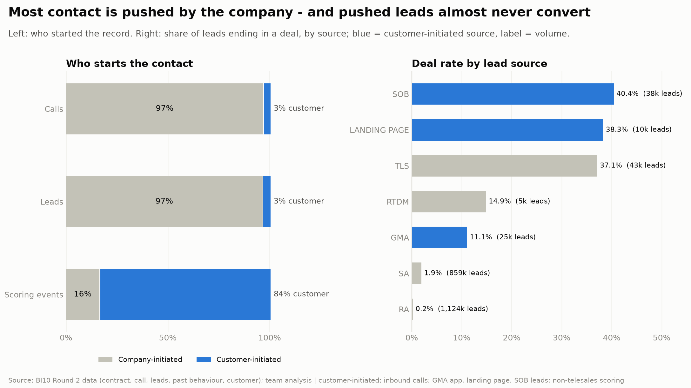
*Figure: Who starts the contact and how leads convert. Source: BI10 Round 2 data, team analysis.*

### Method

Only customer-initiated touches count: self-service and in-store scoring, credit applications, leads the customer created or accepted,
inbound calls, and calls where the customer showed interest or signed. Components (weights): recency 35% (half-life 90 days),
frequency 25% (active days, 12 months), interaction 15% (answer rate on 2025 calls, shrunk to the population rate),
lead activity 10%, product interaction 15% (product families touched + live loan).

### Validation against business outcomes

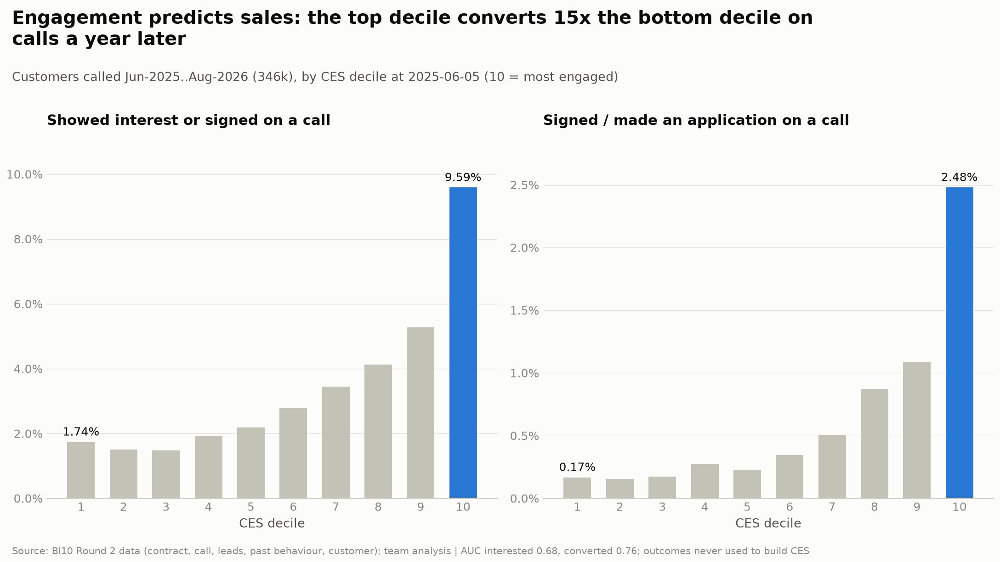
*Figure: Future interest and sales by CES decile. Source: BI10 Round 2 data, team analysis.*

| Check | Result |
|---|---|
| Calls after T: showed interest or signed | AUC 0.68 (call-volume adjusted 0.6528) |
| Calls after T: signed / applied | AUC 0.7594 (adjusted 0.7502) |
| Back-test: score at 2025-02-01, comes back and applies by June | AUC 0.644 |
| Back-test: score at 2025-02-01, signs again by June | AUC 0.6527 |
| Logistic re-weighting on the back-test (in-sample upper bound) | AUC 0.6751 |
| Weight sensitivity (equal weights / recency-heavier) | rank correlation 0.9854 / 0.9968 |
| App usage 2025 (not an input) | users 9.2% in CES 60+ vs 5.9% in CES 20-40 |

### Drivers and segments

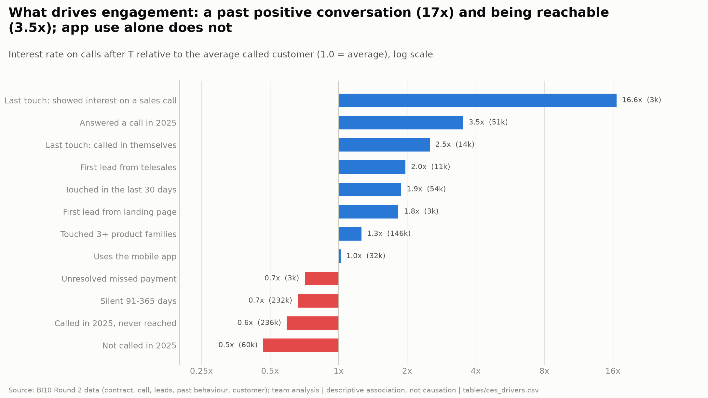
*Figure: Interest lift by observable factor. Source: BI10 Round 2 data, team analysis.*

| ces_segment | customers | share | avg_score | median_days_since_touch | interested_after_T | converted_after_T |
|---|---|---|---|---|---|---|
| Highly engaged | 121,934 | 12.2% | 69.7 | 21 | 7.9% | 2.05% |
| Engaged | 139,445 | 13.9% | 52.2 | 78 | 3.6% | 0.66% |
| Unreachable | 42,635 | 4.3% | 48.1 | 128 | 3.8% | 0.26% |
| Warm | 178,205 | 17.8% | 39.4 | 144 | 2.1% | 0.27% |
| Passive | 518,309 | 51.8% | 29.4 | 154 | 1.4% | 0.18% |

### Call operations

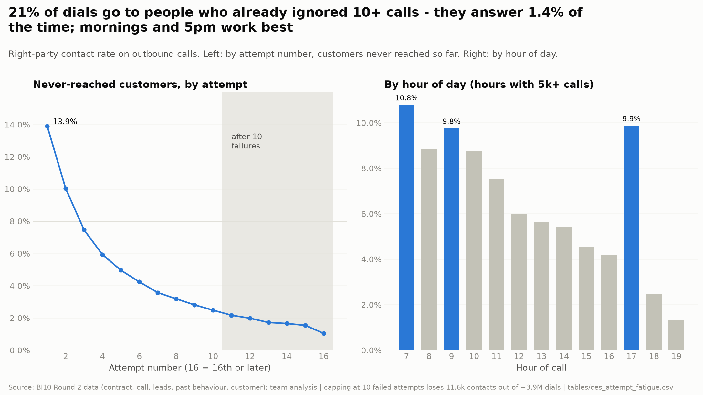
*Figure: Answer rate by attempt and by hour. Source: BI10 Round 2 data, team analysis.*

---

## 4. Health x engagement: where to sell, where to protect

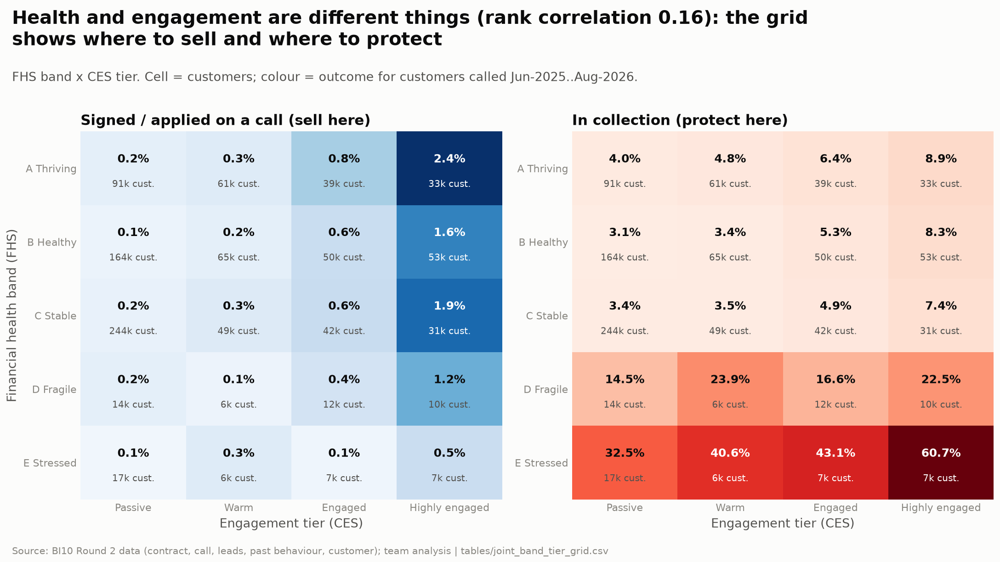
*Figure: FHS band x CES tier with future outcomes. Source: BI10 Round 2 data, team analysis.*

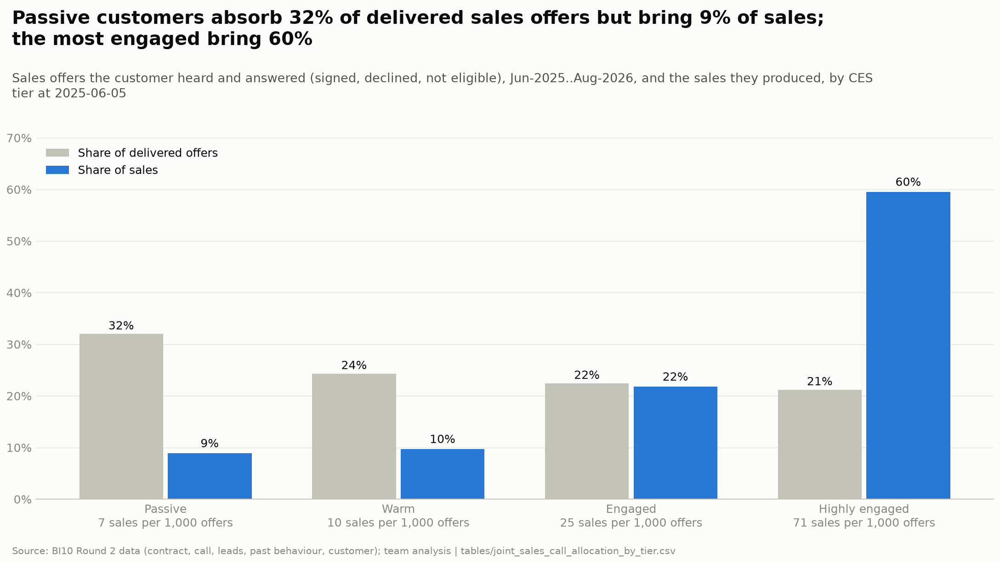
*Figure: Delivered offers vs sales by CES tier. Source: BI10 Round 2 data, team analysis.*

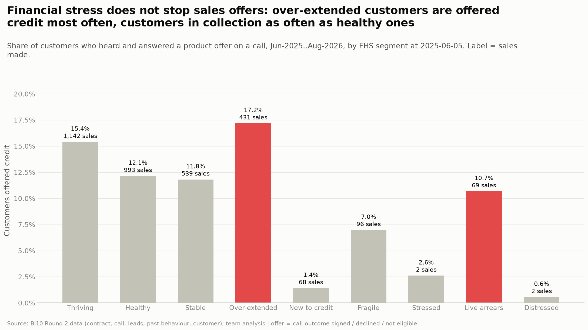
*Figure: Customers offered credit by FHS segment. Source: BI10 Round 2 data, team analysis.*

* The two scores are almost independent (rank correlation 0.1571): engagement does not imply health.
* 174,351 customers are healthy (A/B) and engaged; 74,089 of them were never called after T.
* Engaged customers in band E show interest on calls but end in collection most often - interest there signals need, not capacity.

This grid, with both scores, reasons and explanations per customer in `outputs/customer_scores.csv`, is the input for Challenge 3.

---

## 5. Limitations

* Repayment is observed only on instalments 1-4; later arrears are seen only through collection calls, which cover a
  company-selected list (written-off customers are almost absent).
* The file is the Tet-2025 applicant cohort, not the full book; customers who left before Dec-2024 are not represented.
* Thin-file scores are provisional (AUC 0.526); segment, not score, should drive decisions for them.
* Within bands A-C the score does not separate later collection (2.8%-3.5%); its job there is early-stress ranking.
* All associations are descriptive. Recommendations should be rolled out as controlled tests (e.g. CES-ranked call list vs current list).
* App sessions are a 2025 average with no exact period; they are used only as a validation signal.
